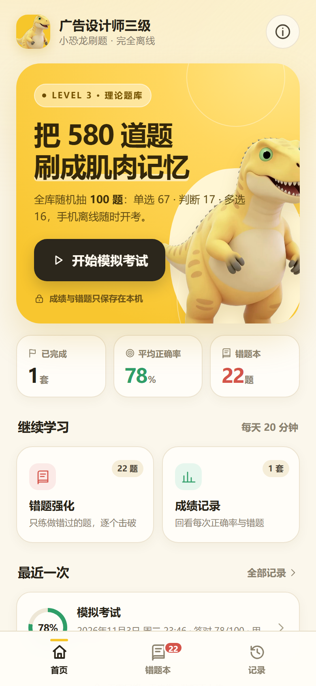

# 广告设计师三级 · 全库随机抽题

一个纯本地离线的刷题 App，题库共 **580 道**（单选 376 / 判断 98 / 多选 106），每套随机抽取 **100 题**（单选 67 / 判断 17 / 多选 16）。

- 无 CDN、无网络请求、无广告、无账号
- 自动计算正确率、错误率、答对/答错/未答
- localStorage 保存历次成绩与错题
- 错题本支持按题型筛选、错题练习、答对移出
- 适配 Android 手机和 iPhone 屏幕，支持刘海/安全区
- 小恐龙图标与启动图已生成



## 文件说明

| 路径 | 用途 |
|---|---|
| `www/index.html` | **最终单文件 App**，题库、样式、逻辑、恐龙图片全部内嵌 |
| `广告设计师三级-离线刷题.html` | 真正的单文件副本（去掉 PWA 外链），方便直接双击/发送到手机打开 |
| `www/manifest.webmanifest` | iPhone“添加到主屏幕”所需配置 |
| `www/sw.js` | 离线缓存，首次打开后可断网使用 |
| `assets/` | 1024 图标、Android 各尺寸图标、iOS 图标和启动图 |
| `input/` | 原始 HTML 和黄色小恐龙原图，供重新生成时使用 |
| `preview/` | 手机端界面预览图 |
| `src/questions.json` | 题库数据 |
| `src/index.template.html` | 页面模板（改功能时用） |
| `tools/build.py` | 把模板 + 题库 + 恐龙图打包成单文件 HTML |
| `tools/generate_icons.py` | 从 `input/1.jpg` 重新生成所有图标 |
| `.github/workflows/build-apk.yml` | 云端自动编译 APK |
| `.github/workflows/deploy-pwa.yml` | 云端发布 iPhone 可安装网页版 |

## 方式一：Android APK（推荐，不需要安装 Android Studio）

### 第 1 步：把项目放上 GitHub

1. 安装 [GitHub Desktop](https://desktop.github.com/)（图形界面，不需要命令行）。
2. 登录 GitHub 账号。
3. 打开 GitHub Desktop，选择 **File → Add local repository**，选中本文件夹 `ad-exam-app`。
4. 如果提示不是 Git 仓库，点 **create a repository**，然后点 **Publish repository**。
5. 建议发布为 **Public**（公开仓库可免费使用 GitHub Pages；私有仓库的 Pages 可能需要付费）。

### 第 2 步：让云端自动编译

上传完成后：

1. 打开这个仓库的 **Actions** 页面。
2. 左侧点击 **打包 Android APK**。
3. 点击右侧 **Run workflow → Run workflow**。
4. 等 3～8 分钟，打开这次运行记录。
5. 页面底部 **Artifacts** 里下载 `ad-exam-apk.zip`。
6. 解压得到 `ad-exam.apk`，传到手机安装。

> 手机安装时如果提示“禁止安装未知来源应用”，在系统设置里允许浏览器/文件管理器安装即可。
>
> 这个 APK 是 Debug 签名的可安装包，适合自己使用和发给朋友；不能直接上架应用商店。

## 方式二：iPhone（不需要苹果开发者账号）

苹果不允许安装未签名的 App，所以 iPhone 用“添加到主屏幕”的离线网页版：

1. 在 GitHub 仓库的 **Settings → Pages** 中，把 **Build and deployment → Source** 设为 **GitHub Actions**。
2. 打开 **Actions → 发布 iPhone 可安装网页版**，等待绿色对勾。
3. 在 iPhone 的 **Safari** 中打开 Pages 给出的网址（形如 `https://你的用户名.github.io/仓库名/`）。
4. 点 Safari 底部的 **分享 → 添加到主屏幕**。
5. 以后从桌面图标打开；第一次联网加载后，之后断网也能用。

> 如果你需要真正的原生 iOS `.ipa` 或上架 App Store，必须有苹果开发者账号（每年 99 美元）和签名证书，这是苹果的平台限制，不是代码问题。项目已经包含 Capacitor iOS 工程支持，有账号后可继续打包。详细步骤见 [docs/iOS.md](docs/iOS.md)。

## 方式三：直接在电脑/手机浏览器打开

双击 `www/index.html` 即可使用。数据保存在当前浏览器；换浏览器或清理浏览器数据会丢失记录。

## 题库说明

- 原题库实际为 **580 题**，旧页面写的“600 题”已改成实时统计。
- 其中 **61 道题**在原题库中自带“答案存疑”标记。App 保留原答案计分，在解析里显示黄色提示，建议对照教材核对。
- 每次考试从全库随机抽题，题目顺序和选项顺序不随机（选项顺序保持题库原顺序，避免打乱“以上都对”类题目）。

## 修改题库或重新生成

如果以后要改题、改图标，在项目根目录运行：

```bash
python tools/build.py
```

只改图标时：

```bash
python tools/generate_icons.py
python tools/build.py
```

需要 Python 3 和 Pillow：

```bash
pip install pillow
```

## 数据保存在哪里

- 成绩：`localStorage` 键 `dinoExam.history.v1`
- 错题：`localStorage` 键 `dinoExam.wrong.v1`
- 未交卷进度：`localStorage` 键 `dinoExam.session.v1`

全部只在本机，不会上传。卸载 App 或清理应用数据会清空记录。

## 常见问题

**Actions 里没有“打包 Android APK”？**  
确认 `.github/workflows/build-apk.yml` 已上传。GitHub 网页上传时隐藏文件夹可能被忽略，用 GitHub Desktop 上传最稳。

**APK 编译失败？**  
打开失败的那一步日志，通常是网络下载 Gradle/SDK 超时，重新 Run workflow 一次即可。仍然失败就把日志发我。

**iPhone 网页打开是空白？**  
确认 Settings → Pages 的 Source 已设为 GitHub Actions，并等部署完成；网址必须是 `https://` 开头。

**安装后图标不是小恐龙？**  
GitHub Actions 会执行 `tools/apply-android-assets.mjs` 覆盖默认图标；如果手动用 Android Studio 打包，需要先运行这个脚本。
